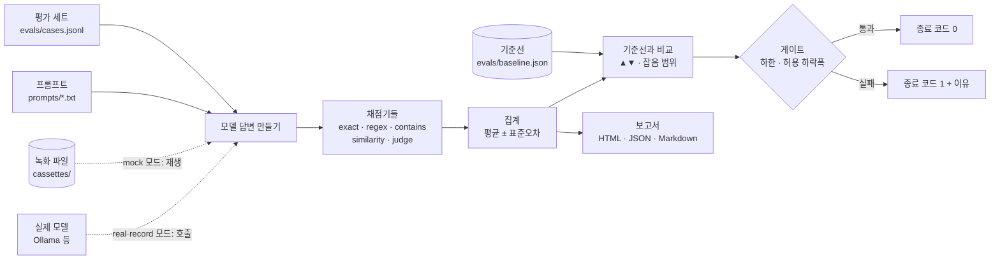

# evalgate — 프롬프트를 고칠 때마다 자동으로 채점하고, 점수가 떨어지면 CI를 빨갛게 만드는 작은 도구

**한국어** | [English](README.en.md)

> **English summary** — evalgate is a tiny, dependency-free Python tool that scores an LLM prompt against a small test set (exact / regex / contains / embedding similarity / LLM judge) and fails CI when scores drop below a floor or fall too far from a saved baseline. `uv run evalgate demo` runs fully offline by replaying recorded model answers, and shows a deliberately broken prompt turning the gate red.


<sub>프롬프트 3종(baseline · improved · regressed)을 같은 8개 문제로 채점한 결과. 마지막 줄 `gate`에서 regressed만 FAIL입니다.</sub>

## 한 줄 요약

프롬프트(AI에게 주는 지시문)를 고쳤을 때, "고쳐서 나빠졌는지"를 사람이 눈으로 보지 않고 **숫자와 종료 코드(0이면 통과, 1이면 실패)** 로 알려 줍니다.

**이런 분께:**
- AI 기능의 프롬프트나 모델을 자주 바꾸는데, 바꾼 뒤 품질이 떨어져도 모르고 지나가는 분
- promptfoo · Inspect 같은 큰 평가 도구가 하는 일의 속을 작은 코드로 먼저 보고 싶은 분
- LLM 심판(AI가 AI의 답을 채점하는 방식)을 믿어도 되는지 감을 잡고 싶은 분

## 왜 알아야 하나요?

식당 주방장이 소스 레시피를 조금 바꿨다고 해 봅시다. 맛이 좋아졌는지 나빠졌는지는 손님이 불평하기 전에는 모릅니다. 그래서 레시피를 바꿀 때마다 같은 메뉴 8개를 똑같은 기준표로 맛보는 사람을 두면 어떨까요? 기준표 점수가 어제보다 많이 내려가면 "이 레시피는 내보내지 마세요" 하고 막아 줍니다.

프롬프트도 같습니다. 한 줄을 지웠을 뿐인데 답변 형식이 전부 깨질 수 있고, 그 사실은 코드 리뷰만으로는 보이지 않습니다. 코드에 **테스트**가 있듯이 프롬프트에도 "평가 세트(같은 문제 묶음) + 채점 기준 + 통과선"이 있으면, 바꿀 때마다 자동으로 확인할 수 있습니다. 이 저장소는 그 최소한의 형태입니다.

## 30초 만에 실행하기

준비물: [uv](https://docs.astral.sh/uv/) (Python 3.14는 uv가 알아서 내려받습니다). 모델·키는 필요 없습니다. 실제 모델 모드에만 [Ollama](https://ollama.com)가 필요합니다.

uv가 없다면 먼저 설치합니다.

```bash
# macOS / Linux
curl -LsSf https://astral.sh/uv/install.sh | sh
# Windows (PowerShell)
powershell -ExecutionPolicy ByPass -c "irm https://astral.sh/uv/install.ps1 | iex"
```

설치 직후에는 **새 터미널을 열거나** `source $HOME/.local/bin/env`(macOS/Linux)를 실행해야 `uv` 명령이 잡힙니다.

```bash
git clone https://github.com/LeeGyeongPil/ai-lab-llm-eval-gate.git
cd ai-lab-llm-eval-gate
uv run --no-dev evalgate demo
```

`--no-dev`는 테스트용 도구(pytest)를 설치하지 않는다는 뜻입니다. 첫 실행에서 uv가 Python과 필요한 최소 구성을 내려받으므로 그 한 번만 인터넷이 필요하고, 그 뒤에는 네트워크 없이 돕니다(`UV_OFFLINE=1`로 확인). 테스트까지 돌려 보려면 `uv run pytest -q`를 쓰세요(pytest를 내려받습니다).

위 화면이 나오고, `reports/demo.html`(점수 보고서, 브라우저로 열기)이 만들어집니다. 1초 안에 끝납니다. 모델을 부르지 않고 **미리 녹화해 둔 모델 답변을 재생**(mock 모드)하기 때문입니다. 채점·집계·게이트는 실제 코드 그대로 돌아갑니다.

실제 로컬 모델로 돌려 보려면:

```bash
ollama pull qwen3:4b && ollama pull bge-m3
uv run evalgate run --mode real --repeats 1
```

M3 16GB 노트북에서 8문제를 한 번씩 도는 데 약 12분(742초)이 걸렸습니다. 같은 GPU를 다른 작업과 나눠 쓴 값이라 장비에 따라 10~15분 이상 걸릴 수 있습니다. `qwen3:4b`는 "생각"을 길게 하는 모델이라 느립니다.

## 단계별로 따라 하기

### 1단계. 점수표 읽기

`uv run evalgate demo`의 표는 프롬프트 3개를 같은 8문제(온라인 서점 고객센터 문의, 문제마다 2번 반복)로 채점한 결과입니다.

| 표기 | 뜻 |
|---|---|
| `0.94±0.06` | 평균 점수 ± **표준오차**(평균이 우연히 얼마나 흔들릴 수 있는지의 크기. 작을수록 믿을 만함) |
| `▲0.06` / `▼0.94` | 기준선(baseline, "지금 합격선으로 삼은 결과") 대비 오른 폭 / 내린 폭 |
| `~` | 변화가 **잡음 범위** 안이라 "진짜 변화인지 알 수 없다"는 표시 |
| `=` | 기준선과 같음 |

- **improved**는 점수가 0.06 올랐지만 전부 `~`입니다. "좋아진 것처럼 보이지만 8문제로는 구분이 안 된다"가 정직한 읽기입니다.
- **regressed**는 일부러 형식 지시를 지운 프롬프트입니다. format·label이 0.00으로 무너졌고 `gate`가 FAIL입니다.

### 2단계. 실패하는 게이트 보기

```bash
uv run evalgate run --mode mock --prompt prompts/regressed.txt --gate
```


<sub>화면은 실패 이유 부분만 잘라 보여 줍니다(실제로는 그 위에 점수표와 `보고서:` 줄이 먼저 나옵니다). 명령 뒤에 `echo $?`를 이어 쓰면 마지막 줄에 종료 코드 `1`이 찍힙니다. CI는 이 1을 보고 빨간 불을 켭니다.</sub>

이유는 두 종류입니다.
- `0.00 < 하한 0.85` — 점수가 절대 하한(**floor**, 이 아래면 무조건 실패)보다 낮다
- `기준선 0.94 대비 -0.94 (허용 하락폭 0.20 초과)` — 합격선으로 삼은 결과보다 허용한 폭 넘게 떨어졌다

종료 코드는 세 가지입니다. 0은 통과, 1은 **게이트 실패(점수 문제)**, 2는 설정·녹화·호출 오류(점수와 무관한 문제)입니다.

### 3단계. 보고서 열기

`reports/demo.html`을 브라우저로 엽니다. 프롬프트마다 카드가 있고, 실패한 카드에는 실패 이유 상자가 붙습니다.


<sub>① baseline은 모든 하한을 충족, ② regressed는 FAIL 배지와 빨간 실패 이유 상자. 카드의 `잡음 범위` 문구가 1단계 점수표의 `~`입니다.</sub>


<sub>같은 지표를 프롬프트끼리 나란히 비교한 그래프. regressed의 format·label 막대가 거의 보이지 않습니다.</sub>

### 4단계. 같은 답, 다른 판정 보기

보고서 아래쪽 케이스 표에서 regressed의 c02를 보면, 같은 답에 채점기마다 다른 판정이 나옵니다.


<sub>① 답변 "단순 변심 반품 시 배송비는 고객님 부담입니다."는 형식 지시("분류: ○○" 첫 줄)를 안 지켜 format ✗·label ✗인데, 심판은 내용이 정책과 맞다며 PASS를 줍니다. 그래서 `채점기 불일치`·`새로 실패` 배지가 붙습니다.</sub>

내용은 맞지만 형식은 틀린 답입니다. 형식을 심판에게만 맡기면 이런 회귀를 놓칩니다. 그래서 형식·라벨은 결정적 채점기로, 정책 사실은 심판으로 나눠 맡겼습니다.

## 어떻게 동작하나요?



1. **평가 세트**의 문제마다, 프롬프트를 시스템 지시로 붙여 모델에게 묻습니다. 온도가 0보다 크면 답이 매번 달라지므로 문제마다 `repeats`번(기본 2회) 반복합니다.
2. 답은 **채점기**가 채점합니다. 채점기는 설정 파일에서 이름을 붙여 정의하고, 문제마다 어떤 채점기를 쓸지 고릅니다.

   | 종류 | 하는 일 | 특징 |
   |---|---|---|
   | `exact` | 정규화(공백·`**` 강조·대소문자 정리) 뒤 정답과 정확히 같은지 | 공짜, 항상 같은 점수. 표현이 조금만 달라도 틀림 |
   | `regex` | 정규식(글자 패턴 검사식)에 맞는지 | 형식 검사에 알맞음 |
   | `contains` | 정답 문구가 들어 있는지 | 핵심 단어 확인 |
   | `similarity` | 모범 답안과의 **임베딩**(글을 숫자 목록으로 바꾼 것) 코사인 유사도가 기준 이상인지 | 주제 이탈 감지용 참고 지표 |
   | `judge` | **LLM 심판**에게 "정책 사실과 맞는가? PASS/FAIL과 이유 한 줄"을 묻기 | 유연하지만 느리고 편향이 있음 |

3. 점수는 문제별 반복 평균을 먼저 내고, 그 값들로 평균과 표준오차를 구합니다. (같은 문제를 여러 번 돌린 점수는 서로 독립이 아니라서, 반복 횟수로 나누면 오차를 작게 잡게 됩니다.)
4. **기준선**과 짝지어 비교합니다. 같은 문제끼리 뺀 차이의 표준오차를 구해, 변화가 그 **2배(±2×SE) 안**이면 잡음 범위(`~`)로 표시합니다. 이 표시는 보고서용이고 게이트 판정은 아래 두 규칙만 씁니다.
5. **게이트**는 설정 파일의 규칙 두 개를 확인합니다. 코드는 약 40줄입니다.

   ```toml
   [gate]
   min_scores = { format = 0.85, label = 0.85, judge = 0.60 }  # 절대 하한
   max_drop = 0.20                                              # 기준선 대비 허용 하락폭
   ```

   하한 미달이거나 기준선보다 0.20 넘게 떨어지면 실패 이유를 출력하고 종료 코드 1로 끝납니다. GitHub Actions에서는 실패 이유가 빨간 `::error` 주석으로도 나오고 단계 요약에 점수 표가 붙습니다(저장소 공개 후 화면 캡처는 이 README에 없습니다. 지금은 코드와 테스트로만 확인했습니다).

### 설정 파일

채점기와 게이트는 `evalgate.toml` 하나에서 정합니다.


<sub>채점기 4개(regex · exact · judge · similarity) 정의와 `[gate]` 규칙. 이름(format, label…)이 케이스 파일과 게이트에서 그대로 쓰입니다.</sub>

## 내 프로젝트에 붙이기

도구는 표준 라이브러리만 쓰므로(런타임 의존성 0개) 폴더를 복사하면 끝입니다.

**1. 복사할 것** — 아래 파일만 복사하면 됩니다(`pyproject.toml`·테스트·`regressed.txt`는 필요 없습니다).

```text
src/evalgate/                      # 도구 본체 (표준 라이브러리만 사용)
evalgate.toml                      # 채점기 정의 · 게이트 기준
evals/cases.jsonl                  # 내 평가 세트
evals/baseline.json                # 기준선 (4단계에서 새로 만들어 교체)
prompts/baseline.txt               # 내 현재 프롬프트
cassettes/qwen3-4b.jsonl           # 예시 녹화 파일 (4단계에서 지우고 내 것으로 새로 녹화)
docs/adopt/eval-gate.yml           # CI → 내 프로젝트의 .github/workflows/eval-gate.yml 로 복사
```

복사한 `evalgate.toml` 맨 아래의 `[demo]` 섹션은 이 저장소의 `evalgate demo` 전용입니다(`prompts/improved.txt`·`regressed.txt`를 가리킴). 내 프로젝트에는 그 파일이 없으니 섹션을 지우거나 `demo`를 쓰지 마세요(쓰면 종료 코드 2). 또 보고서가 `reports/`에 쌓이므로 내 `.gitignore`에 `reports/`를 추가하세요.

Python 3.14 이상과 [uv](https://docs.astral.sh/uv/)가 필요합니다. 도구는 `PYTHONPATH=src python -m evalgate.cli ...`로 실행합니다(예: `PYTHONPATH=src uv run --no-project --python 3.14 python -m evalgate.cli run --mode mock --gate`). 복사한 예시 케이스·녹화는 내 것으로 바꾸기 전까지 이 저장소의 예시 그대로 통과합니다.

**2. 평가 세트 쓰기** — `evals/cases.jsonl`에 한 줄이 한 문제입니다.

```json
{"id": "c01", "input": "어제 주문했는데 언제쯤 받을 수 있나요?", "expected": {"label": "배송", "facts": "결제 후 2영업일 이내 출고, 출고 후 1~2일 안에 도착", "reference": "결제 후 2영업일 이내에 출고되며 출고 후 1~2일 안에 도착합니다."}, "scorers": ["format", "label", "judge", "on_topic"]}
```

`expected` 안의 키 이름은 마음대로 정하고, 채점기 설정(`expected = "label"`)이 그 키를 가리킵니다.

**3. 채점기와 게이트 정하기** — `evalgate.toml`의 `[scorers.*]`를 고치고 `[gate]` 값을 처음엔 기준선 점수보다 조금 낮게 잡습니다.

**4. 실제 모델로 녹화하고 기준선 저장하기**

먼저 복사해 온 **예시 녹화 파일을 지웁니다**(`rm cassettes/qwen3-4b.jsonl`). 지우지 않으면 `record`는 "이미 녹화된 요청"이라며 모델을 한 번도 부르지 않고 건너뛰고(종료 코드 0), 내 평가 세트 대신 예시 답변이 남습니다. 이 경우 도구가 `경고: 모델을 한 번도 부르지 않았습니다`를 출력합니다. 이 단계는 Ollama(또는 호환 엔드포인트)가 켜져 있어야 합니다.

```bash
export PYTHONPATH=src
uv run --no-project --python 3.14 python -m evalgate.cli run --mode record --prompt prompts/baseline.txt   # 실모델 호출 + 녹화 추가
uv run --no-project --python 3.14 python -m evalgate.cli baseline                                          # 합격 결과를 evals/baseline.json 으로
```

`record`는 이미 녹화된 요청은 건너뛰므로 오래 걸리는 녹화를 끊었다가 같은 명령으로 이어 할 수 있습니다. 다시 녹화하려면 `--overwrite`입니다. 녹화에는 최종 답·심판 판정·임베딩만 저장하고 생각 과정은 저장하지 않습니다. 다른 OpenAI 호환 엔드포인트를 쓰려면 `.env.example`에 적힌 `EVALGATE_BASE_URL`·`EVALGATE_API_KEY`·`EVALGATE_MODEL`을 셸에서 `export`하세요(`.env` 파일은 자동으로 읽지 않습니다)(우선순위: 명령행 > 환경변수 > toml).

**5. CI에 연결하기** — `docs/adopt/eval-gate.yml`을 내 프로젝트의 `.github/workflows/eval-gate.yml`로 복사하세요. 핵심은 게이트 한 줄이며, 점수가 기준을 못 넘으면 종료 코드 1로 이 단계가 빨갛게 됩니다. 비밀값은 쓰지 않습니다.

```yaml
- run: uv run --no-project --python 3.14 python -m evalgate.cli run --mode mock --prompt prompts/baseline.txt --gate --name gate
  env:
    PYTHONPATH: src
```

이 저장소의 워크플로(`.github/workflows/eval-gate.yml`)는 여기에 단위 테스트, "일부러 망가뜨린 프롬프트는 게이트가 반드시 실패시키는지" 자가검사(종료 코드가 정확히 1이어야 초록), 문법·시크릿 검사를 더한 것입니다. 이 저장소 개발용이라 복사하지 않습니다.

**6. 프롬프트를 고치는 PR에서** — 새 프롬프트로 `--mode record`를 한 번 돌려 녹화 파일을 **같이 커밋**하세요. 녹화에 없는 요청이면 CI가 종료 코드 2로 실패하며 녹화 명령을 안내합니다. 의도된 동작입니다(조용히 통과하는 것보다 낫습니다).

```text
오류: 녹화에 없는 요청입니다: c01 반복1 생성 (key …, 녹화 파일 qwen3-4b.jsonl).
  프롬프트·모델·설정을 바꿨다면 실모델로 녹화한 뒤 녹화 파일을 함께 커밋하세요:
  PYTHONPATH=src uv run --no-project --python 3.14 python -m evalgate.cli run --mode record --prompt <프롬프트 파일>
```

더 자세한 절차와 mock · real 비교는 [docs/adopt.md](docs/adopt.md), 채점기 선택·잡음 개념은 [docs/concepts.md](docs/concepts.md)에 있습니다.

## mock과 real, 무엇이 다른가

| 방식 | 장점 | 단점 |
|---|---|---|
| mock(녹화 재생, 기본) | 비밀값·모델 불필요, 결정적, 수 초 | 녹화를 사람이 갱신해야 함, 녹화된 답의 채점만 검증 |
| real(실모델 호출) | 지금 모델의 실제 답을 확인 | 느림·비용, 비결정적, 키 관리 |

큰 도구와의 전체 대응표(promptfoo·Inspect)는 [docs/concepts.md](docs/concepts.md#큰-도구와의-대응)에 있습니다.

## 코드 둘러보기

| 파일 | 하는 일 |
|---|---|
| [`src/evalgate/cli.py`](src/evalgate/cli.py) | `demo` · `run` · `gate` · `baseline` 명령, 종료 코드 |
| [`src/evalgate/config.py`](src/evalgate/config.py) | `evalgate.toml` · 환경변수 · 명령행 옵션 합치기 |
| [`src/evalgate/providers.py`](src/evalgate/providers.py) | 모델 호출(표준 `urllib`)과 녹화 재생·저장 |
| [`src/evalgate/runner.py`](src/evalgate/runner.py) | 문제 × 반복마다 답변 → 채점, 결과 순서 고정 |
| [`src/evalgate/scorers.py`](src/evalgate/scorers.py) | exact · regex · contains · similarity · judge |
| [`src/evalgate/stats.py`](src/evalgate/stats.py) | 평균 · 표준오차 · 기준선 비교 · 잡음 범위 |
| [`src/evalgate/gate.py`](src/evalgate/gate.py) | 게이트 판정(약 40줄) |
| [`src/evalgate/report.py`](src/evalgate/report.py) | 외부 요청 없는 단일 HTML 보고서 |
| [`tests/`](tests) | 단위 · 엔드투엔드 테스트 30개 |

**핵심 1. 게이트는 숫자 비교입니다.** 하한과 비교하고, 기준선 대비 하락폭과 비교하고, 이유 문장을 모아 돌려줍니다. 비어 있으면 통과입니다.

```python
elif cur["mean"] < floor:
    failures.append(f"지표 {metric}: {cur['mean']:.2f} < 하한 {floor:.2f}")
```

**핵심 2. 심판이 못 읽히면 FAIL입니다.** 심판 응답이 `판정: PASS|FAIL` 형식이 아니면 점수 0과 `parse_error`로 기록합니다. 읽지 못한 것을 통과로 치면 점수가 부풀기 때문입니다.

**핵심 3. mock은 모델 응답 공급원만 가짜입니다.** 요청 키는 모델·메시지·온도·시드·반복 번호를 묶은 해시입니다. 프롬프트가 한 글자만 달라도 키가 달라져 "녹화에 없음"(종료 코드 2)으로 드러납니다.

## 용어 사전

| 용어 | 뜻 |
|---|---|
| 프롬프트 | AI에게 주는 지시문 |
| 평가 세트 | 같은 조건으로 계속 돌려 보는 문제 묶음 (코드의 테스트 케이스에 해당) |
| 채점기(scorer) | 답 하나에 점수(0~1)를 매기는 규칙 |
| LLM 심판 | 다른(또는 같은) AI에게 "이 답이 기준과 맞나?"를 묻는 채점 방식 |
| 임베딩 | 글의 뜻을 숫자 목록(벡터)으로 바꾼 것. 두 글의 숫자가 비슷하면 뜻이 비슷하다고 봄 |
| 코사인 유사도 | 두 숫자 목록이 얼마나 같은 방향인지(1에 가까울수록 비슷) |
| 기준선(baseline) | "이 정도면 합격"으로 저장해 둔 이전 결과. 새 결과를 여기에 비교 |
| 게이트 | 점수가 기준을 못 넘으면 종료 코드 1로 막는 관문 |
| 하한(floor) | 평균이 이 값 아래면 무조건 실패하는 절대선 |
| 표준오차(SE) | 평균이 우연으로 흔들릴 수 있는 크기. 평가 문제가 적으면 커짐 |
| 잡음 범위 | 기준선과의 차이가 표준오차 약 2배 이내라 "진짜 변화인지 모르는" 구간 |
| 녹화 재생(cassette) | 모델 답변을 파일에 저장해 두고 나중에 모델 없이 되돌려 주는 방식 |
| 종료 코드 | 프로그램이 끝날 때 남기는 숫자. 0 성공, 0이 아니면 실패 — CI가 이걸 봄 |
| CI | 코드를 올릴 때마다 자동으로 테스트를 돌리는 장치 (예: GitHub Actions) |

## 직접 바꿔 보기

1. **게이트 조이기** — `evalgate.toml`의 `max_drop`을 `0.20` → `0.05`로 → `uv run evalgate demo`를 다시 돌리면 판정은 그대로 PASS · PASS · FAIL입니다(이 예시는 regressed가 이미 크게 무너져 있어서). 달라지는 것은 regressed의 실패 이유 문구가 `(허용 하락폭 0.05 초과)`로 바뀌는 것뿐입니다. 판정이 바뀌는 것을 보려면 3번처럼 새 프롬프트를 녹화해 점수가 조금만 떨어지는 경우를 만들어 보세요.
2. **하한 올리기** — `min_scores`의 `judge`를 `0.60` → `0.80`으로 → baseline(0.75)도 FAIL이 됨 → 게이트 목록에서 `지표 judge: 0.75 < 하한 0.80`을 확인. 이때 `demo`는 "baseline·improved는 통과, regressed는 실패"가 아니면 마지막에 `예상과 다른 게이트 결과입니다`라는 경고를 내고 종료 코드 1로 끝납니다. 오류가 아니라 시연이 의도와 달라졌다는 알림이니, 확인 뒤 값을 `0.60`으로 되돌리세요.
3. **새 프롬프트 만들기** — `prompts/baseline.txt`를 복사해 한 줄을 고치고 `--prompt`로 실행 → 녹화에 없으므로 종료 코드 2와 녹화 안내가 나옴 → 실모델이 있다면 `--mode record`로 녹화한 뒤 다시 실행.
4. **채점기 바꾸기** — `[scorers.label]`의 `type`을 `contains`로 바꿔 보기 → 정확 일치보다 느슨하게 채점되는지 점수 변화를 비교.
5. **심판 모델 분리** — `EVALGATE_JUDGE_MODEL`에 다른 모델을 지정하고 `--mode real` → 같은 모델이 자기 답을 채점할 때와 점수가 달라지는지 비교.

## 자주 겪는 문제

| 증상 | 원인 | 해결 |
|---|---|---|
| `오류: 녹화에 없는 요청입니다` (종료 코드 2) | 프롬프트·모델·설정을 바꿨는데 그 요청이 녹화에 없음 | `PYTHONPATH=src uv run --no-project --python 3.14 python -m evalgate.cli run --mode record --prompt <파일>` 후 녹화 파일을 함께 커밋 |
| `requires-python` 오류 / 이상한 Python 버전 | 3.14 미만이거나 uv가 다른 버전을 고름 | `uv python install 3.14` (저장소의 `.python-version`이 3.14로 고정) |
| 실모드에서 연결 오류 | Ollama가 꺼져 있거나 모델을 안 받음 | `ollama serve`, `ollama pull qwen3:4b` 와 `ollama pull bge-m3`, 주소는 `EVALGATE_BASE_URL` |
| 실모드가 너무 느림 | 생각 모델 + 심판 호출이 문제마다 있음 | `--repeats 1`, 더 작은 세트, 생각 없는 모델로 교체(이 저장소에서 검증한 범위 밖) |
| 같은 명령인데 실모드 점수가 녹화와 다름 | 모델 비결정성(같은 시드라도 부하에 따라 달라질 수 있음) | 정상입니다. 반복 횟수를 늘리고 `±`를 함께 보세요 |
| 판정에 `parse_error` | 심판 응답이 비었거나 형식이 아님 | 점수 0으로 처리됨(의도). `max_tokens`·컨텍스트 길이를 늘려 다시 녹화 |

## 한계

솔직하게 적습니다. 이 도구가 보증하지 않는 것들입니다.

- **8문제는 적습니다.** 한 문제가 12.5%p이고 표준오차도 큽니다(judge 0.75±0.13). `0.03` 같은 차이는 판단할 수 없고, improved의 +0.06도 전부 잡음 범위입니다. 문제 수를 늘리거나 반복을 늘려야 합니다.
- **심판은 편향됩니다.** 같은 모델이 자기 답을 채점하면 후하게 줄 수 있습니다(이 데모는 피평가 모델과 심판이 같은 `qwen3:4b`입니다). 두 답을 비교시키면 순서에 따라 승자가 바뀌는 위치 편향도 알려져 있습니다. 이 도구는 이진 판정(PASS/FAIL)만 쓰고 쌍대 비교는 구현하지 않았습니다. 가능하면 다른 심판 모델을 쓰고, 사람이 소량 라벨링해 일치율을 확인하세요.
- **심판이 흔들리고 때로 비어 있습니다.** 녹화된 모델 응답(chat) 95건 중 3건(전부 심판)이 빈 문자열이라 `parse_error` FAIL로 기록됐고, baseline의 judge 점수(0.75)를 깎았습니다. 원인은 생각이 `max_tokens`를 넘었거나 컨텍스트가 작았던 탓으로 추정만 하며 확인하지 못했습니다. 점수를 부풀리지 않는 동작을 보이려고 일부러 다시 녹화하지 않았습니다.
- **임베딩 유사도로 정답을 가리지 못합니다.** 실측에서 정반대 뜻의 문장이 맞는 표현(0.767)과 거의 같은 유사도(0.734)가 나왔습니다. 그래서 `on_topic`은 게이트에 쓰지 않는 참고 지표입니다.
- **mock 게이트는 녹화된 답변만 다시 채점합니다.** "녹화된 응답이 기준을 넘는가"만 검증합니다. 녹화 파일을 사람이 조작하면 통과시킬 수 있고, 모델이 지금도 같은 답을 내는지는 알 수 없습니다. 실제 모델로 검증하려면 CI에 비밀값을 넣고 `--mode real`로 돌려야 하는데, 이 방식은 이 저장소에서 검증하지 않았습니다.
- **측정 환경이 한 곳입니다.** 한 대의 노트북(M3 16GB)과 한 모델(qwen3:4b)에서만 잰 값입니다.
- **GitHub Actions 화면은 아직 실제로 보지 못했습니다.** 워크플로 문법은 검사했지만, 저장소 공개 후 실행 화면은 이 README에 넣지 못했습니다.

## 다음 단계

- 두 답을 비교하는 쌍대(pairwise) 심판: 위치 편향을 줄이려면 순서를 바꿔 두 번 물어야 합니다(미구현).
- 사람이 소량 라벨링해 심판과의 일치율을 재 보기.
- 케이스 수를 늘려 잡음(표준오차)을 줄이기.

## 더 알아보기

- [promptfoo — 평가 설정과 채점 종류](https://www.promptfoo.dev/docs/configuration/expected-outputs/) · [GitHub Actions 연동](https://www.promptfoo.dev/docs/integrations/github-action/)
- [Inspect — Scorers](https://inspect.aisi.org.uk/scorers.html)
- [DeepEval — Getting started](https://deepeval.com/docs/getting-started)
- Zheng 외, ["Judging LLM-as-a-Judge with MT-Bench and Chatbot Arena"](https://arxiv.org/abs/2306.05685) (2023) — 심판의 편향
- Wang 외, ["Large Language Models are not Fair Evaluators"](https://arxiv.org/abs/2305.17926) (2023) — 위치 편향
- Miller, ["Adding Error Bars to Evals"](https://arxiv.org/abs/2411.00640) (2024) — 평가 점수의 표준오차
- [Ollama — OpenAI 호환 API](https://docs.ollama.com/api/openai-compatibility)
- [GitHub Actions — 워크플로 명령(`::error`, 단계 요약)](https://docs.github.com/en/actions/reference/workflows-and-actions/workflow-commands)

큰 도구와의 대응(evalgate → promptfoo): `exact`·`regex`·`contains` → `equals`·`regex`·`contains`, `similarity` → `similar`, `judge` → `llm-rubric`, `--gate` → 통과율 임계값과 종료 코드.

## 라이선스

MIT — [LICENSE](LICENSE). 예제에 쓴 `qwen3:4b`(Qwen3-4B-Thinking-2507)와 `bge-m3`는 각 모델의 라이선스를 따르며, 이 저장소에는 두 모델의 가중치가 포함되어 있지 않습니다(모델이 만든 답변 녹화만 포함).
