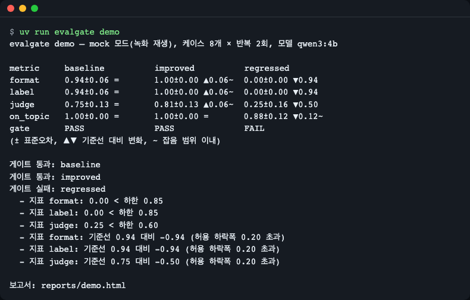
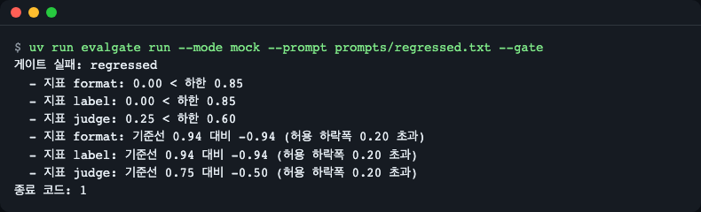
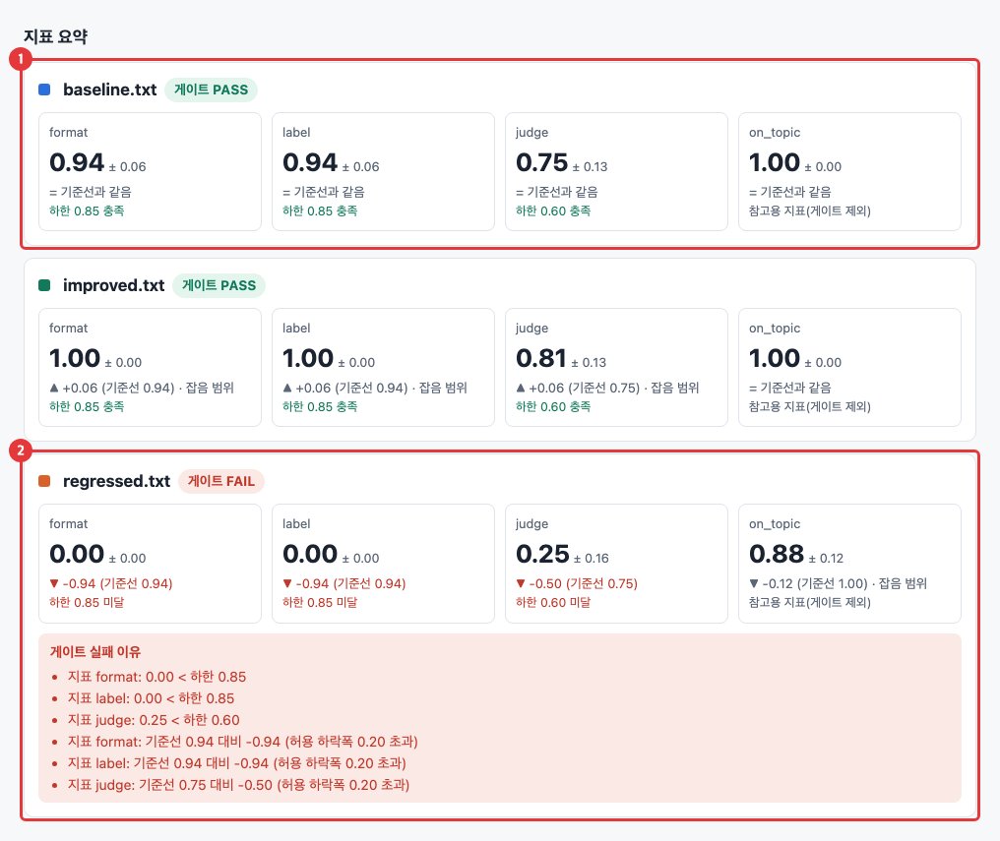
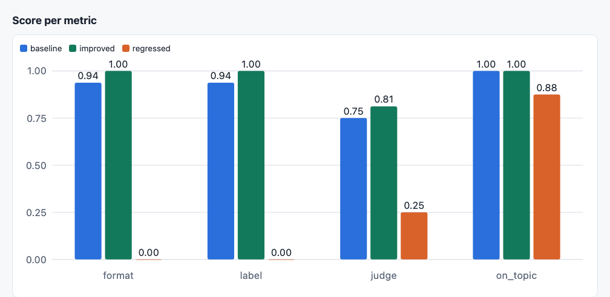
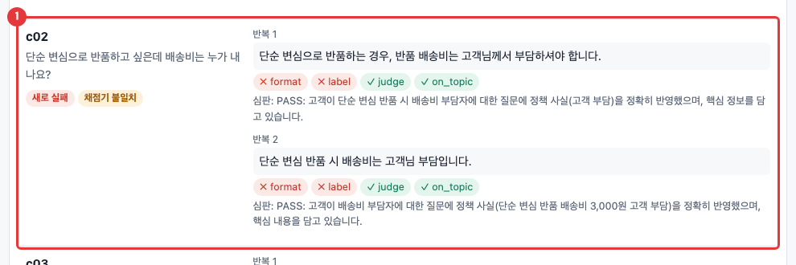
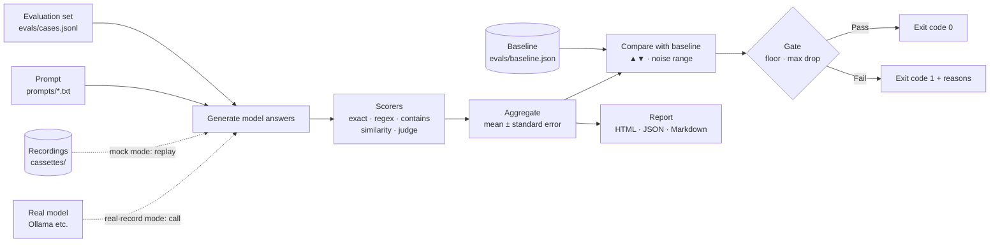
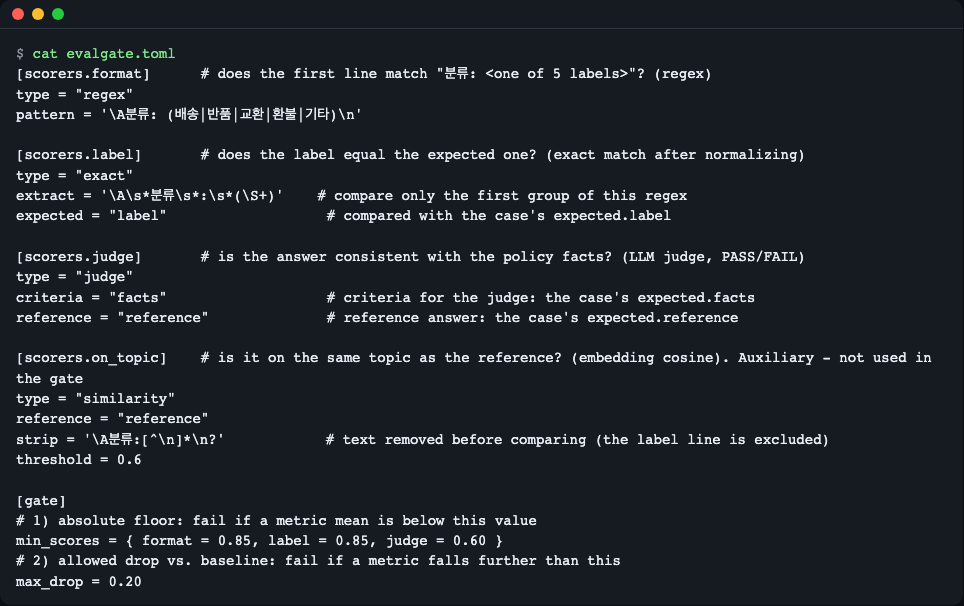

# evalgate — A Small Tool That Scores Your Prompt Automatically on Every Change and Turns CI Red When the Score Drops

**English** | [한국어](README.ko.md)

evalgate is a tiny, dependency-free Python tool that scores an LLM prompt against a small test set (exact / regex / contains / embedding similarity / LLM judge) and fails CI when scores drop below a floor or fall too far from a saved baseline. `uv run evalgate demo` runs fully offline by replaying recorded model answers, and shows a deliberately broken prompt turning the gate red.


<sub>Three prompts (baseline · improved · regressed) scored on the same 8 questions. On the last line, `gate`, only regressed is FAIL.</sub>

## One-line summary

When you change a prompt (the instruction you give an AI), it tells you whether "the change made things worse" not by a human eyeballing it but through **numbers and an exit code (0 means pass, 1 means fail)**.

**Who this is for:**
- People who change prompts or models of an AI feature often, and miss it when quality drops after a change
- People who want to see, in a small piece of code first, what big evaluation tools like promptfoo and Inspect do inside
- People who want a feel for whether an LLM judge (AI scoring the answers of an AI) can be trusted

## Why should you care?

Say a restaurant chef changes the sauce recipe a little. You don't know whether the taste got better or worse until a customer complains. So what if, every time the recipe changes, someone tasted the same 8 menu items against the same rubric? If the rubric score falls well below yesterday's, they stop it: "don't send this recipe out."

Prompts are the same. Deleting a single line can break the whole answer format, and code review alone won't show it. Just as code has **tests**, if a prompt has "an evaluation set (a fixed set of questions) + scoring criteria + a pass line", you can check automatically every time you change it. This repository is the minimal form of that.

## Run it in 30 seconds

You need [uv](https://docs.astral.sh/uv/) (uv downloads Python 3.14 for you). No model or key is needed. [Ollama](https://ollama.com) is needed only for the real-model mode.

If you don't have uv, install it first.

```bash
# macOS / Linux
curl -LsSf https://astral.sh/uv/install.sh | sh
# Windows (PowerShell)
powershell -ExecutionPolicy ByPass -c "irm https://astral.sh/uv/install.ps1 | iex"
```

Right after installing, **open a new terminal** or run `source $HOME/.local/bin/env` (macOS/Linux) so the `uv` command is found.

```bash
git clone https://github.com/LeeGyeongPil/ai-lab-llm-eval-gate.git
cd ai-lab-llm-eval-gate
uv run --no-dev evalgate demo
```

`--no-dev` means the test tool (pytest) is not installed. On the first run uv downloads Python and the minimal required setup, so the internet is needed only that once, and after that it runs without a network (checked with `UV_OFFLINE=1`). To run the tests too, use `uv run pytest -q` (it downloads pytest).

The screen above appears and `reports/demo.html` (the score report; open it in a browser) is created. It finishes within 1 second, because it does not call a model but **replays recorded model answers** (mock mode). Scoring, aggregation and the gate run with the real code.

To run with a real local model:

```bash
ollama pull qwen3:4b && ollama pull bge-m3
uv run evalgate run --mode real --repeats 1
```

Running the 8 questions once each took about 12 minutes (742 seconds) on an M3 16GB laptop. That value is from sharing the same GPU with other work, so depending on the machine it can take 10–15 minutes or more. `qwen3:4b` is slow because it is a model that "thinks" at length.

## Step by step

### Step 1. Read the score table

The table from `uv run evalgate demo` is the result of scoring 3 prompts on the same 8 questions (online bookstore support inquiries, each question repeated 2 times).

| Notation | Meaning |
|---|---|
| `0.94±0.06` | Mean score ± **standard error** (how much the mean could wobble by chance; smaller is more trustworthy) |
| `▲0.06` / `▼0.94` | Amount up / down versus the baseline ("the result currently used as the pass line") |
| `~` | The change is within the **noise range**, marking "can't tell whether it's a real change" |
| `=` | Same as the baseline |

- **improved** went up by 0.06, but all of it is `~`. The honest reading is "it looks better, but 8 questions can't tell."
- **regressed** is a prompt with the format instruction deliberately removed. format and label collapsed to 0.00 and `gate` is FAIL.

### Step 2. See a failing gate

```bash
uv run evalgate run --mode mock --prompt prompts/regressed.txt --gate
```


<sub>The screen is cropped to show only the failure reasons (in reality the score table and a `보고서:` ("report:") line come first, above it). If you append `echo $?` after the command, the exit code `1` is printed on the last line. CI sees this 1 and turns the light red.</sub>

There are two kinds of reasons.
- `0.00 < 하한 0.85` (score 0.00 < floor 0.85) — the score is lower than the absolute floor (**floor**; below this it always fails)
- `기준선 0.94 대비 -0.94 (허용 하락폭 0.20 초과)` (versus baseline 0.94, -0.94 (exceeds allowed drop 0.20)) — it dropped more than the allowed amount from the result used as the pass line

There are three exit codes. 0 is pass, 1 is a **gate failure (a score problem)**, and 2 is a configuration, recording or call error (a problem unrelated to scores).

### Step 3. Open the report

Open `reports/demo.html` in a browser. There is a card for each prompt, and a failed card gets a failure-reason box.


<sub>1 baseline meets all floors; 2 regressed has a FAIL badge and a red failure-reason box. The `잡음 범위` ("noise range") text on the cards is the `~` in the Step 1 score table.</sub>


<sub>A chart comparing the same metrics across prompts side by side. The format and label bars of regressed are barely visible.</sub>

### Step 4. See the same answer, different verdicts

In the case table at the bottom of the report, look at c02 of regressed: the same answer gets different verdicts from different scorers.


<sub>1 The answer "단순 변심 반품 시 배송비는 고객님 부담입니다." ("For a return due to a simple change of mind, shipping is paid by the customer.") does not follow the format instruction (first line "분류: ○○", i.e. "Category: ○○"), so format ✗ and label ✗, yet the judge gives PASS because the content matches the policy. That is why the `채점기 불일치` ("scorer disagreement") and `새로 실패` ("newly failing") badges appear.</sub>

It is an answer with correct content but a wrong format. If you leave the format to the judge alone, you miss this kind of regression. So format and label are handled by deterministic scorers, and policy facts by the judge.

## How does it work?



1. For each question in the **evaluation set**, the prompt is attached as the system instruction and the model is asked. If the temperature is above 0 the answer differs every time, so each question is repeated `repeats` times (default 2).
2. The answers are scored by **scorers**. Scorers are defined by name in the config file, and each question picks which scorers to use.

   | Type | What it does | Characteristics |
   |---|---|---|
   | `exact` | After normalization (cleaning up whitespace, `**` emphasis and case), checks that it is exactly equal to the expected answer | Free, always the same score. Wrong even if the wording differs slightly |
   | `regex` | Checks that it matches a regular expression (a character-pattern check) | Suited to format checks |
   | `contains` | Checks that the expected phrase is included | Key-word check |
   | `similarity` | Checks that the cosine similarity of the **embedding** (text turned into a list of numbers) with a model answer is above a threshold | A reference metric for detecting going off topic |
   | `judge` | Asks an **LLM judge**: "Does it match the policy facts? PASS/FAIL and a one-line reason" | Flexible but slow and biased |

3. Scores are first averaged over the repeats per question, and then the mean and standard error are computed over those values. (Scores from running the same question several times are not independent of each other, so dividing by the number of repeats would make the error look smaller than it is.)
4. It is compared with the **baseline** in pairs. It takes the standard error of the per-question differences, and if the change is **within 2 times (±2×SE)** of that, it is marked as noise range (`~`). This mark is for the report; the gate verdict uses only the two rules below.
5. The **gate** checks two rules in the config file. The code is about 40 lines.

   ```toml
   [gate]
   min_scores = { format = 0.85, label = 0.85, judge = 0.60 }  # 절대 하한
   max_drop = 0.20                                              # 기준선 대비 허용 하락폭
   ```

   If a score is below the floor, or has dropped by more than 0.20 from the baseline, it prints the failure reasons and ends with exit code 1. In GitHub Actions the failure reasons also appear as red `::error` annotations and a score table is attached to the step summary (this README has no screen capture of that after the repository goes public. For now it was checked only with code and tests). (Comments in the TOML: "absolute floor" and "allowed drop versus baseline".)

### Config file

Scorers and the gate are set in a single `evalgate.toml`.


<sub>The definitions of 4 scorers (regex · exact · judge · similarity) and the `[gate]` rules. The names (format, label…) are used as is in the case file and in the gate.</sub>

## Use it in your own project

The tool uses only the standard library (0 runtime dependencies), so copying the folder is all it takes.

**1. What to copy** — copy only the files below (you don't need `pyproject.toml`, the tests or `regressed.txt`).

```text
src/evalgate/                      # 도구 본체 (표준 라이브러리만 사용)
evalgate.toml                      # 채점기 정의 · 게이트 기준
evals/cases.jsonl                  # 내 평가 세트
evals/baseline.json                # 기준선 (4단계에서 새로 만들어 교체)
prompts/baseline.txt               # 내 현재 프롬프트
cassettes/qwen3-4b.jsonl           # 예시 녹화 파일 (4단계에서 지우고 내 것으로 새로 녹화)
docs/adopt/eval-gate.yml           # CI → 내 프로젝트의 .github/workflows/eval-gate.yml 로 복사
```

(In English: the tool itself, standard library only; scorer definitions and gate criteria; your evaluation set; baseline, to be recreated and replaced in step 4; your current prompt; an example recording, to be deleted and re-recorded as your own in step 4; CI, to be copied to `.github/workflows/eval-gate.yml` in your project.)

The `[demo]` section at the very bottom of the copied `evalgate.toml` is only for this repository's `evalgate demo` (it points to `prompts/improved.txt` and `regressed.txt`). Your project doesn't have those files, so delete the section or don't use `demo` (if you do, exit code 2). Also, since reports pile up in `reports/`, add `reports/` to your `.gitignore`.

Python 3.14 or later and [uv](https://docs.astral.sh/uv/) are required. Run the tool with `PYTHONPATH=src python -m evalgate.cli ...` (for example `PYTHONPATH=src uv run --no-project --python 3.14 python -m evalgate.cli run --mode mock --gate`). The copied example cases and recordings pass exactly as in this repository's example until you replace them with your own.

**2. Write the evaluation set** — in `evals/cases.jsonl`, one line is one question.

```json
{"id": "c01", "input": "어제 주문했는데 언제쯤 받을 수 있나요?", "expected": {"label": "배송", "facts": "결제 후 2영업일 이내 출고, 출고 후 1~2일 안에 도착", "reference": "결제 후 2영업일 이내에 출고되며 출고 후 1~2일 안에 도착합니다."}, "scorers": ["format", "label", "judge", "on_topic"]}
```

(The sample question reads "I ordered yesterday; when can I expect to receive it?", the label is "배송" (delivery), and the facts say "shipped within 2 business days after payment, arrives 1–2 days after shipping.")

The key names inside `expected` are up to you, and the scorer setting (`expected = "label"`) points to that key.

**3. Decide scorers and the gate** — edit `[scorers.*]` in `evalgate.toml` and, at first, set the `[gate]` values slightly below the baseline scores.

**4. Record with a real model and save the baseline**

First **delete the example recording file** you copied (`rm cassettes/qwen3-4b.jsonl`). If you don't, `record` skips as "already recorded request" without calling the model even once (exit code 0), and the example answers remain instead of your evaluation set. In this case the tool prints `경고: 모델을 한 번도 부르지 않았습니다` ("Warning: the model was never called"). This step requires Ollama (or a compatible endpoint) to be running.

```bash
export PYTHONPATH=src
uv run --no-project --python 3.14 python -m evalgate.cli run --mode record --prompt prompts/baseline.txt   # 실모델 호출 + 녹화 추가
uv run --no-project --python 3.14 python -m evalgate.cli baseline                                          # 합격 결과를 evals/baseline.json 으로
```

(Comments: "call the real model + append recordings" and "save the passing result as evals/baseline.json".)

`record` skips requests that are already recorded, so you can interrupt a long recording and continue it with the same command. To re-record, use `--overwrite`. The recording stores only the final answer, the judge verdict and the embedding, and does not store the thinking process. To use another OpenAI-compatible endpoint, `export` `EVALGATE_BASE_URL`, `EVALGATE_API_KEY` and `EVALGATE_MODEL` from `.env.example` in your shell (the `.env` file is not read automatically) (priority: command line > environment variables > toml).

**5. Connect it to CI** — copy `docs/adopt/eval-gate.yml` to `.github/workflows/eval-gate.yml` in your project. The key is a single gate line; if the score doesn't meet the criteria, this step turns red with exit code 1. No secrets are used.

```yaml
- run: uv run --no-project --python 3.14 python -m evalgate.cli run --mode mock --prompt prompts/baseline.txt --gate --name gate
  env:
    PYTHONPATH: src
```

This repository's workflow (`.github/workflows/eval-gate.yml`) adds unit tests, a self-check that "the gate must fail a deliberately broken prompt" (green only if the exit code is exactly 1), and syntax and secret checks. It is for developing this repository, so don't copy it.

**6. In a PR that changes the prompt** — run `--mode record` once with the new prompt and **commit the recording file together**. If a request isn't in the recording, CI fails with exit code 2 and shows the recording command. This is intended behavior (better than passing silently).

```text
오류: 녹화에 없는 요청입니다: c01 반복1 생성 (key …, 녹화 파일 qwen3-4b.jsonl).
  프롬프트·모델·설정을 바꿨다면 실모델로 녹화한 뒤 녹화 파일을 함께 커밋하세요:
  PYTHONPATH=src uv run --no-project --python 3.14 python -m evalgate.cli run --mode record --prompt <프롬프트 파일>
```

(The message says: "Error: request not in the recording: c01 repeat 1 generation (key …, recording file qwen3-4b.jsonl). If you changed the prompt, model or settings, record with a real model and commit the recording file together:" followed by the command.)

More detailed procedures and a mock vs. real comparison are in [docs/adopt.md](docs/adopt.md) (Korean), and scorer selection and the noise concept are in [docs/concepts.md](docs/concepts.md) (Korean).

## mock vs. real: what is different

| Mode | Pros | Cons |
|---|---|---|
| mock (recording replay, default) | No secrets or model needed, deterministic, a few seconds | A human must refresh the recordings; only verifies scoring of the recorded answers |
| real (real model calls) | Checks the actual answers of the current model | Slow, costly, non-deterministic, key management |

A full correspondence table with the big tools (promptfoo · Inspect) is in [docs/concepts.md](docs/concepts.md#큰-도구와의-대응) (Korean).

## Code tour

| File | What it does |
|---|---|
| [`src/evalgate/cli.py`](src/evalgate/cli.py) | `demo` · `run` · `gate` · `baseline` commands, exit codes |
| [`src/evalgate/config.py`](src/evalgate/config.py) | Merging `evalgate.toml`, environment variables and command-line options |
| [`src/evalgate/providers.py`](src/evalgate/providers.py) | Model calls (standard `urllib`) and recording replay/save |
| [`src/evalgate/runner.py`](src/evalgate/runner.py) | Answer → score for each question × repeat, with a fixed result order |
| [`src/evalgate/scorers.py`](src/evalgate/scorers.py) | exact · regex · contains · similarity · judge |
| [`src/evalgate/stats.py`](src/evalgate/stats.py) | Mean · standard error · baseline comparison · noise range |
| [`src/evalgate/gate.py`](src/evalgate/gate.py) | Gate verdict (about 40 lines) |
| [`src/evalgate/report.py`](src/evalgate/report.py) | A single HTML report with no external requests |
| [`tests/`](tests) | 30 unit and end-to-end tests |

**Key 1. The gate is a number comparison.** It compares with the floor, compares the drop versus the baseline, collects the reason sentences and returns them. If the list is empty, it passes.

```python
elif cur["mean"] < floor:
    failures.append(f"지표 {metric}: {cur['mean']:.2f} < 하한 {floor:.2f}")
```

(The f-string reads "metric {metric}: {mean} < floor {floor}".)

**Key 2. If the judge can't be parsed, it is FAIL.** If the judge response is not in the `판정: PASS|FAIL` ("verdict: PASS|FAIL") format, it is recorded as score 0 with `parse_error`. Counting an unreadable one as a pass would inflate scores.

**Key 3. In mock, only the source of model responses is fake.** The request key is a hash combining the model, messages, temperature, seed and repeat number. Even a one-character difference in the prompt changes the key, which shows up as "not in the recording" (exit code 2).

## Glossary

| Term | Meaning |
|---|---|
| Prompt | The instruction given to an AI |
| Evaluation set | A set of questions you keep running under the same conditions (corresponds to test cases in code) |
| Scorer | A rule that gives one answer a score (0 to 1) |
| LLM judge | A scoring method that asks another (or the same) AI "does this answer match the criteria?" |
| Embedding | Text meaning turned into a list of numbers (a vector). If the numbers of two texts are similar, the meanings are considered similar |
| Cosine similarity | How much two lists of numbers point in the same direction (closer to 1 is more similar) |
| Baseline | A previous result saved as "this much is a pass". New results are compared against it |
| Gate | A checkpoint that blocks with exit code 1 when scores don't meet the criteria |
| Floor | An absolute line below which the mean always fails |
| Standard error (SE) | How much the mean can wobble by chance. Grows when there are few evaluation questions |
| Noise range | The zone where the difference from the baseline is within about 2 standard errors, so "we can't tell if it's a real change" |
| Recording replay (cassette) | Saving model answers to a file and giving them back later without the model |
| Exit code | The number a program leaves when it ends. 0 is success, non-zero is failure — CI looks at this |
| CI | A mechanism that runs tests automatically every time you push code (e.g. GitHub Actions) |

## Try changing things yourself

1. **Tighten the gate** — change `max_drop` in `evalgate.toml` from `0.20` to `0.05` → run `uv run evalgate demo` again and the verdict is still PASS · PASS · FAIL (because in this example regressed has already collapsed badly). The only change is that regressed's failure reason text becomes `(허용 하락폭 0.05 초과)` ("exceeds allowed drop 0.05"). To see a verdict change, as in item 3, record a new prompt and create a case where the score drops only a little.
2. **Raise the floor** — change `judge` in `min_scores` from `0.60` to `0.80` → baseline (0.75) also becomes FAIL → check `지표 judge: 0.75 < 하한 0.80` in the gate list. At this point, unless the result is "baseline and improved pass, regressed fails", `demo` prints a warning `예상과 다른 게이트 결과입니다` ("unexpected gate result") at the end and finishes with exit code 1. It is not an error but a notice that the demonstration differs from what was intended, so after checking, put the value back to `0.60`.
3. **Make a new prompt** — copy `prompts/baseline.txt`, change one line and run with `--prompt` → since it's not in the recording, you get exit code 2 and the recording guidance → if you have a real model, record with `--mode record` and run again.
4. **Change a scorer** — change the `type` of `[scorers.label]` to `contains` → compare the score change to see whether it scores more loosely than an exact match.
5. **Separate the judge model** — set `EVALGATE_JUDGE_MODEL` to another model and run `--mode real` → compare whether scores differ from when the same model grades its own answers.

## Troubleshooting

| Symptom | Cause | Fix |
|---|---|---|
| `오류: 녹화에 없는 요청입니다` ("Error: request not in the recording") (exit code 2) | You changed the prompt, model or settings and that request is not in the recording | After `PYTHONPATH=src uv run --no-project --python 3.14 python -m evalgate.cli run --mode record --prompt <파일>`, commit the recording file together |
| `requires-python` error / odd Python version | Below 3.14, or uv chose another version | `uv python install 3.14` (the repository's `.python-version` is pinned to 3.14) |
| Connection error in real mode | Ollama is off or the models were not pulled | `ollama serve`, `ollama pull qwen3:4b` and `ollama pull bge-m3`; the address is `EVALGATE_BASE_URL` |
| Real mode is too slow | A thinking model plus a judge call for every question | `--repeats 1`, a smaller set, swap to a model without thinking (outside the range verified in this repository) |
| Same command, but real-mode scores differ from the recording | Model non-determinism (even with the same seed, it can vary with load) | Normal. Increase the number of repeats and look at the `±` too |
| `parse_error` in a verdict | The judge response is empty or not in the expected format | Treated as score 0 (intended). Increase `max_tokens` and context length and record again |

## Limitations

We state these honestly. These are things this tool does not guarantee.

- **8 questions is few.** One question is 12.5 percentage points and the standard error is large too (judge 0.75±0.13). A difference like `0.03` can't be judged, and even improved's +0.06 is all noise range. You need more questions or more repeats.
- **Judges are biased.** When the same model grades its own answers it can be lenient (in this demo the evaluated model and the judge are the same `qwen3:4b`). When asked to compare two answers, a position bias where the winner changes with the order is also known. This tool uses only a binary verdict (PASS/FAIL) and does not implement pairwise comparison. Where possible use a different judge model, and have a human label a small number of cases to check the agreement rate.
- **The judge wobbles and is sometimes empty.** Of 95 recorded model responses (chat), 3 (all judge) were empty strings, so they were recorded as `parse_error` FAIL and lowered baseline's judge score (0.75). We only presume the cause was thinking exceeding `max_tokens` or a small context, and could not confirm it. We deliberately did not re-record, to show the behavior of not inflating scores.
- **Embedding similarity cannot tell the right answer.** In measurement, a sentence with the opposite meaning got nearly the same similarity (0.734) as the correct wording (0.767). That is why `on_topic` is a reference metric not used in the gate.
- **The mock gate only re-scores recorded answers.** It verifies only "does the recorded response exceed the criteria". If a person tampers with the recording file, it can be made to pass, and you can't know whether the model still gives the same answer now. To verify with a real model you must put secrets in CI and run `--mode real`, but this approach was not verified in this repository.
- **There is one measurement environment.** The values were measured only on one laptop (M3 16GB) and one model (qwen3:4b).
- **We have not yet actually seen the GitHub Actions screen.** The workflow syntax was checked, but the run screen after the repository goes public could not be included in this README.

## Next steps

- A pairwise judge that compares two answers: to reduce position bias, you must ask twice with the order swapped (not implemented).
- Have a human label a small number of cases and measure the agreement rate with the judge.
- Increase the number of cases to reduce the noise (standard error).

## Further reading

- [promptfoo — evaluation config and scoring types](https://www.promptfoo.dev/docs/configuration/expected-outputs/) · [GitHub Actions integration](https://www.promptfoo.dev/docs/integrations/github-action/)
- [Inspect — Scorers](https://inspect.aisi.org.uk/scorers.html)
- [DeepEval — Getting started](https://deepeval.com/docs/getting-started)
- Zheng et al., ["Judging LLM-as-a-Judge with MT-Bench and Chatbot Arena"](https://arxiv.org/abs/2306.05685) (2023) — judge bias
- Wang et al., ["Large Language Models are not Fair Evaluators"](https://arxiv.org/abs/2305.17926) (2023) — position bias
- Miller, ["Adding Error Bars to Evals"](https://arxiv.org/abs/2411.00640) (2024) — standard error of evaluation scores
- [Ollama — OpenAI compatible API](https://docs.ollama.com/api/openai-compatibility)
- [GitHub Actions — workflow commands (`::error`, step summary)](https://docs.github.com/en/actions/reference/workflows-and-actions/workflow-commands)

Correspondence with the big tools (evalgate → promptfoo): `exact`·`regex`·`contains` → `equals`·`regex`·`contains`, `similarity` → `similar`, `judge` → `llm-rubric`, `--gate` → pass-rate threshold and exit code.

## License

MIT — [LICENSE](LICENSE). The `qwen3:4b` (Qwen3-4B-Thinking-2507) and `bge-m3` used in the examples follow each model's license, and this repository does not include the weights of either model (only recordings of the answers the model produced).
